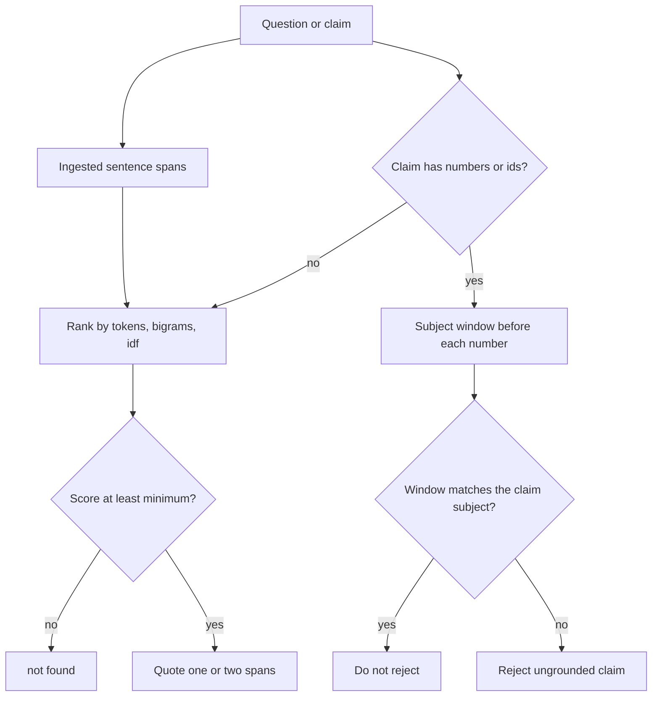

# Design

## Overview

`DocumentAgent` in `src/grave_truth/skeleton.py` is an extractive agent. It stores sentence spans, ranks them by lexical overlap, and either quotes the winning spans or says `not found`. Claims are checked separately: a number is evidence only inside the words that precede it.

No model is called. The ranker is deterministic so the gold suite can run offline in a hook.

## Architecture

## Components and Interfaces

- `DocumentAgent.ingest(doc_id, text)` replaces spans for that id.
- `DocumentAgent.retrieve(question, limit=4)` returns the selected spans in document order.
- `DocumentAgent.answer(question)` returns a `GroundedAnswer`. `answer` asks retrieve for at most two spans.
- `DocumentAgent.reject_ungrounded_claim(claim)` scans every stored span, not only the top hit, so a true clause is not missed because another sentence ranked higher. It still requires the subject window, so a lower-ranked sentence cannot donate its number to the wrong subject.
- `Citation` carries `doc_id`, `span`, `start`, and `end`.
- Query aliases (`doctor` to `provider`, `renter` to `resident`, `termination` to `terminate`) are added on the question side only. Inflections such as `pay`/`paid` are folded on both sides.
- If a content word in the question is absent from the corpus and is not one of those aliases, retrieve returns nothing. That is what keeps "employer" or "prior authorization" from borrowing the word "patient" or "number".

Ranking drops boilerplate bigrams such as "explanation of benefits" so they cannot outvote a subject word like `provider`. A second span is added only when it covers a subject word the first span lacks and its score is close, except when the question is a bare number: near-tie spans are all kept so a shared amount stays visible.

The subject window is the 60 characters before the number. Support requires overlap with the claim's content words. Weak words (`amount`, `fee`, `day`) do not count as the subject by themselves.

## Data Models

- Span: document id, sentence text, start, end.
- Normalized number: kind (`num` or `pct`) plus a canonical decimal. `$1,850.00`, `1850`, and `1,850` share `num:1850`. `20%` is `pct:20` and does not equal `num:20`.
- Identifier: regex `LETTERS-DIGITS`, compared case-insensitively, for values such as `CLM-20481`.

## Error Handling

- Blank ingest raises `ValueError`.
- A citation that does not match the stored slice becomes `not found`.
- An empty corpus rejects every claim.
- Unknown gold-case expectations fail the grader.

## Testing Strategy

- `evals/gold_cases.json` covers cited answers, abstention, rejection, and accepted grounded claims on both fixtures.
- `tests/test_skeleton.py` keeps the original behavior checks.
- `tests/test_grounding.py` checks slice equality, swapped figures, and re-ingest.
- `tests/test_properties.py` builds small synthetic documents and checks that answer numbers stay inside citations and that invented amounts are rejected.
- `evals/adversarial_cases.json` locks the contradiction rule used during the change. `evals/holdout_cases.json` was measured once afterward and was not used to edit the ranker.
- The Kiro hook `.kiro/hooks/evals-on-save.json` runs `python3 evals/run_evals.py` after relevant saves. `.kiro/hooks/run-evals.json` remains the original on-save hook.

## Contradiction

The rarest subject word in the question is the focus. A figure counts toward that focus only when the focus word is in the text between the previous number and this number, and that prefix does not contain `not`, `never`, `no`, or `without`. Two different normalized figures for that focus set `conflict` and both original spans are returned. `$240` and `$240.00` are one figure. A second subject in the same question is not a conflict. A negated figure is dropped when a positive figure for the same focus exists. A document that only negates a figure, and the form `USD 240`, are known gaps recorded by the holdout.
