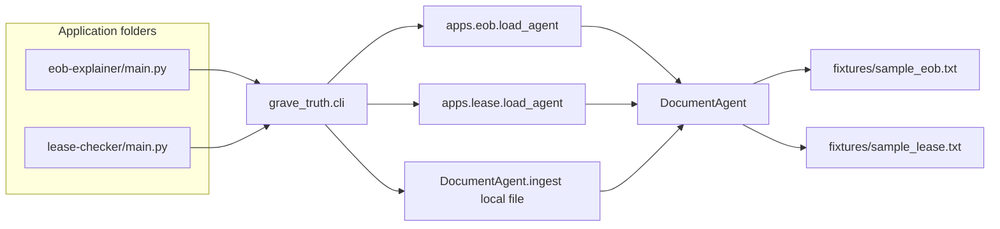

# Design

## Overview

The library in `src/grave_truth` is the skeleton. `grave_truth.apps.eob` and `grave_truth.apps.lease` each ingest one fixture. The folders `eob-explainer/` and `lease-checker/` are the two applications a reviewer runs. They add the repo `src` directory to `sys.path` and call `grave_truth.cli`, so they work before an editable install.

## Architecture

## Components and Interfaces

- `eob.explain(question)` and `lease.check_clause(question)` return a `GroundedAnswer`.
- `python3 -m grave_truth` prints plain text. `--json` prints the same fields for tests.
- `reject` does not use a failing exit code for a rejected claim. Rejection is a result, printed as `Rejected: yes`. A missing file exits 2.
- Default questions: patient responsibility for the EOB, monthly rent for the lease.

## Data Models

The CLI prints `App`, `Question`, `Found`, `Ghost`, `Answer`, and `Citations`. Each citation line is `doc_id [start:end] span`. JSON uses the same fields with `found`, `ghost`, `answer`, and `citations`.

## Error Handling

- Unknown app name or a missing file prints `error:` on stderr and returns exit code 2.
- A question with no support prints `Found: no` and `Answer: not found`.
- The process does not retry, call an API, or substitute a guessed number.

## Testing Strategy

- `tests/test_cli.py` runs the library entry point, both application folders, rejection, abstention, and file mode.
- Gold cases drive both fixtures through `load_agent`.
- App READMEs repeat the research-demo limit so a reviewer who opens only one folder still sees it.
